<a href="https://justekal-map.vercel.app">
  
</a>

<p align="center">
  <a href="https://git.io/typing-svg">
    
  </a>
</p>

<p align="center">
  <a href="https://justekal-map.vercel.app"></a>
  <a href="https://forgemods.de/creators/justekal"></a>
  <a href="https://bsky.app/profile/justekal.be"></a>
  <a href="https://x.com/justekal_"></a>
  
</p>

---

### `> whoami`

```yaml
name:      Nathanaël "JusteKal" Canas Perez
location:  Belgium 🇧🇪
role:      FiveM mapper — MindCity RP (since 03/2025)
sells_on:  forgemods.de/creators/justekal
pipeline:  [Blender, Sollumz, CodeWalker]
side_quest: self-taught front-end dev — Vue, Nuxt, TypeScript
currently: shipping maps, polishing my blueprint-style portfolio,
           and building small tools I actually use every day
```

<details>
<summary><b>🗺️ What I do as a mapper</b></summary>
<br>

- **Custom MLOs & exteriors** modelled in Blender, exported with Sollumz, assembled in CodeWalker.
- **Optimised for servers** — LODs, collisions, occlusion, clean `ymap` / `ytyp` / `ydr` streaming.
- **Made for roleplay** — interiors designed around how players actually move and interact.
- Every project is documented on my **[portfolio](https://justekal-map.vercel.app)** with before/after shots, plans and videos.

</details>

---

### 🧰 Toolbox

<table>
  <tr>
    <td align="center" width="140"><b>Mapping</b></td>
    <td>
      
      
      
      
    </td>
  </tr>
  <tr>
    <td align="center"><b>Front-end</b></td>
    <td></td>
  </tr>
  <tr>
    <td align="center"><b>Other langs</b></td>
    <td></td>
  </tr>
  <tr>
    <td align="center"><b>Tooling</b></td>
    <td></td>
  </tr>
</table>

---

### 🛠️ Featured builds

<table>
  <tr>
    <td width="50%" valign="top">
      <h4>🗺️ <a href="https://justekal-map.vercel.app">Mapping Portfolio</a></h4>
      Blueprint-themed showcase of my FiveM maps — interactive Leaflet map, GSAP animations, FR/EN.<br><br>
      
      
      
    </td>
    <td width="50%" valign="top">
      <h4>🚕 <a href="https://github.com/JusteKal/TaxiPannel">TaxiPannel</a></h4>
      Builds the animated roof-ad atlas for MindCity's LS Taxi: drop images, crossfade, export a 2×2 GIF ready for the game.<br><br>
      
      
      <a href="https://justekal.github.io/TaxiPannel/"></a>
    </td>
  </tr>
  <tr>
    <td valign="top">
      <h4>🔎 <a href="https://github.com/JusteKal/FxNatives">FxNatives</a></h4>
      Flow Launcher plugin to search every FiveM / GTA V native — name, hash, signature &amp; docs — without leaving the keyboard.<br><br>
      
      
    </td>
    <td valign="top">
      <h4>🎵 <a href="https://github.com/JusteKal/mc_pearhud">Pear HUD</a></h4>
      Minecraft mod showing the song playing in Pear Desktop: cover art, progress bar, slides in and tucks itself away.<br><br>
      
      
    </td>
  </tr>
  <tr>
    <td valign="top">
      <h4>🍐 <a href="https://github.com/JusteKal/Flow.Launcher.Plugin.PearDesktop">Pear Desktop for Flow Launcher</a></h4>
      Control Pear Desktop (YouTube Music) from Flow Launcher — play, skip, search, zero dependencies.<br><br>
      
      
    </td>
    <td valign="top">
      <h4>🏝️ IslandBar <sub><code>WIP</code></sub></h4>
      A Dynamic-Island-style floating pill for Windows — media, calendar, file tray, Bluetooth, quick launch.<br><br>
      
      
    </td>
  </tr>
</table>

<p align="center"><sub>
  Also: <a href="https://weekend.justekal.be">est-ce que c'est bientôt le weekend ?</a> ·
  <a href="https://github.com/JusteKal/sheets-dark-edge">sheets-dark-edge</a> ·
  contributions to <a href="https://github.com/Electron-Minecraft-Launcher/EML-AdminTool">EML-AdminTool</a>
</sub></p>

---

### 📊 Activity

<p align="center">
  
</p>
<p align="center">
  
  
</p>
<p align="center">
  
</p>

---

<p align="center">
  
</p>
<p align="center"><sub><code>// drawn by JusteKal · scale 1:1 · rev 2026.11</code></sub></p>
